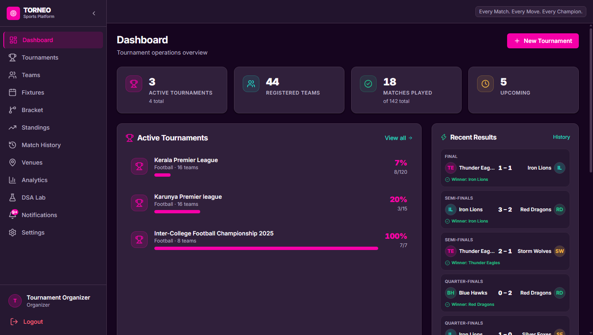

# Torneo

**Every Match. Every Move. Every Champion.**

Torneo is a tournament management platform with a React dashboard and a FastAPI backend. It helps organizers manage tournaments, teams, venues, fixtures, results, and standings, while providing a visual lab for exploring the data structures and algorithms used behind tournament operations.



## Features

- **Tournament management** - create and manage tournaments, teams, venues, fixtures, and match results.
- **Brackets and standings** - generate tournament brackets, record scores, and follow rankings.
- **Analytics and notifications** - review tournament insights and stay informed about updates.
- **DSA Lab** - explore bubble sort, binary search, tournament trees, and graph traversal (BFS/DFS) through tournament data.
- **Role-based demo accounts** - try the interface as an administrator, organizer, or viewer.
- **API documentation** - browse and try the backend endpoints with the interactive Swagger UI.

## Tech stack

| Area | Technologies |
| --- | --- |
| Frontend | React, TypeScript, Vite, Tailwind CSS |
| Backend | Python, FastAPI, SQLAlchemy, Pydantic |
| Database | SQLite by default |

## Requirements

- Python 3.10 or newer
- Node.js 20.19+ or 22.12+, with npm

## Run locally

### 1. Start the backend

From the project root:

```powershell
cd backend
python -m venv .venv
.\.venv\Scripts\Activate.ps1
python -m pip install -r requirements.txt
Copy-Item .env.example .env
```

Edit `backend/.env` and set `SECRET_KEY` to a long, random value. Then create the demo data and start the API:

```powershell
python seed.py
python -m uvicorn app.main:app --reload
```

The backend runs at `http://localhost:8000`. The SQLite database is created in the backend working directory.

### 2. Start the frontend

In a second terminal, from the project root:

```powershell
cd frontend
npm ci
npm run dev
```

Open the frontend at `http://localhost:5173`. By default it connects to `http://localhost:8000/api`. To use another API URL, set `VITE_API_URL` in `frontend/.env.local`.

### Demo accounts

The seed script creates these local demo accounts:

| Role | Email | Password |
| --- | --- | --- |
| Admin | `admin@torneo.app` | `Admin@123` |
| Organizer | `organizer@torneo.app` | `Org@123` |
| Viewer | `viewer@torneo.app` | `View@123` |

These credentials are for local development only. Do not use them in a deployed environment.

## API and checks

- Interactive API docs: `http://localhost:8000/api/docs`
- ReDoc: `http://localhost:8000/api/redoc`
- Health check: `http://localhost:8000/api/health`

From `frontend/`, run the available frontend checks:

```powershell
npm run build
npm run lint
```

## Project layout

```text
backend/
  app/
    algorithms/     DSA implementations
    api/            FastAPI routers
    core/            Settings and security
    db/              Database setup
    models/          SQLAlchemy models
    services/        Brackets, rankings, exports, and audit logic
  requirements.txt
  seed.py
frontend/
  src/
    components/
    pages/
    lib/
screenshots/
```

## Project documents

- [Complete project report](Torneo_Complete_Project_Report.pdf)
- [DSA report](FRONT_DSA.pdf)
- [Micro project report](Torneo_Micro_Project_E_Report_Final.docx)
